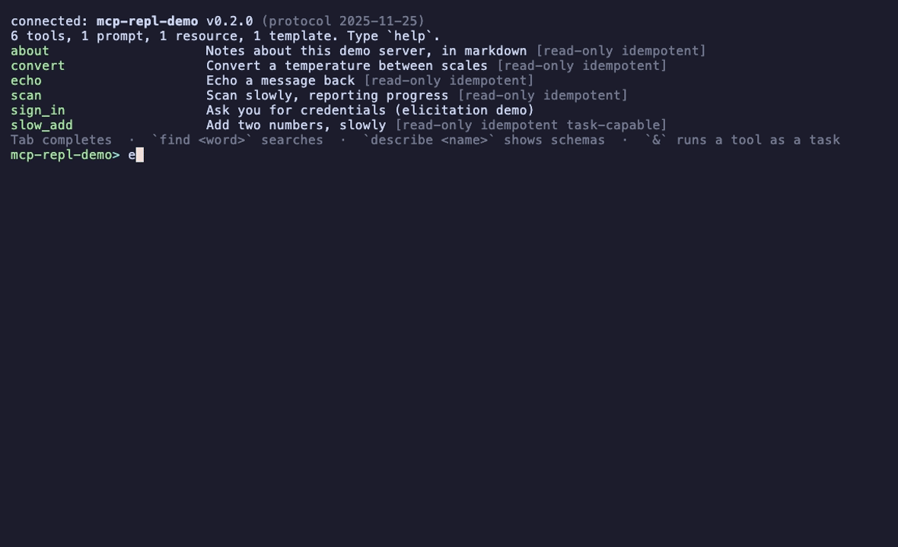
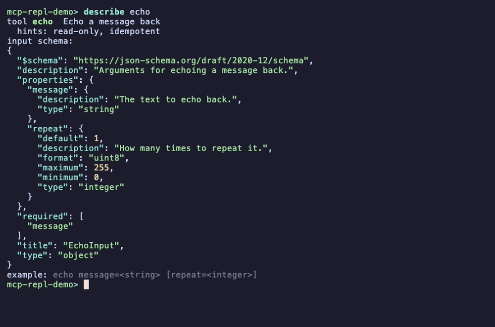
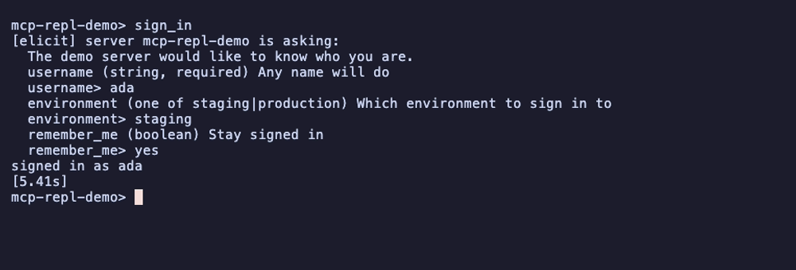
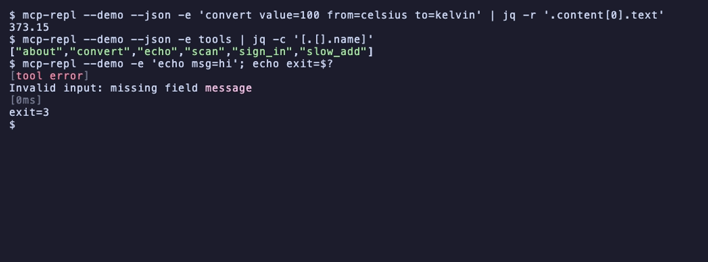

# mcp-repl

[](https://crates.io/crates/mcp-repl)
[](https://docs.rs/mcp-repl)
[](https://github.com/joshrotenberg/mcp-repl/actions/workflows/ci.yml)
[](#license)

Interactive REPL and one-shot CLI for [MCP](https://modelcontextprotocol.io)
servers, over stdio or streamable HTTP.

- Each server tool is a top-level command. Arguments are `key=value`, coerced
  by the tool's `inputSchema`.
- Prompts and resources have built-ins.
- Tab completion comes from the schema and from server `completion/complete`.
- The command table refreshes on `list_changed` notifications.
- `-e` and generated subcommands run a single call and exit, with NDJSON
  output and typed exit statuses.



## Install

```bash
brew install joshrotenberg/brew/mcp-repl   # macOS, Linux
cargo install --locked mcp-repl            # Rust 1.95.0+
docker run --rm -it ghcr.io/joshrotenberg/mcp-repl --demo
```

Shell installer (installs to `$CARGO_HOME/bin` and edits shell startup files
unless `MCP_REPL_NO_MODIFY_PATH=1`):

```bash
curl --proto '=https' --tlsv1.2 -LsSf https://github.com/joshrotenberg/mcp-repl/releases/latest/download/mcp-repl-installer.sh | sh
```

- **Archives:** prebuilt macOS, Linux and Windows archives are on the
  [latest release](https://github.com/joshrotenberg/mcp-repl/releases/latest).
- **Container:** suited to `--http` and `--demo`. It has no stdio servers and
  no OAuth credential store; see
  [In a container](https://github.com/joshrotenberg/mcp-repl/blob/main/docs/connecting.md#in-a-container).
- **Verification:** releases ship SHA-256 checksums, an SBOM, GitHub artifact
  attestations, and container provenance; see
  [Verify a downloaded release](https://github.com/joshrotenberg/mcp-repl/blob/main/docs/releases.md#verify-a-downloaded-release).

Completions and man page:

```bash
mcp-repl --completions zsh > ~/.zfunc/_mcp-repl
mcp-repl --man > /usr/local/share/man/man1/mcp-repl.1
```

## Quick start

`--demo` runs a bundled demo server. It needs no config, network or
credentials.

```text
$ mcp-repl --demo
mcp-repl-demo> help
mcp-repl-demo> echo message="hello"
mcp-repl-demo> convert value=100 from=celsius to=fahrenheit
mcp-repl-demo> describe convert
mcp-repl-demo> read note://ideas
```

- `help <command>` prints usage and examples.
- `find <word>` searches tools, prompts, resources, templates and built-ins.
- `describe <tool>` prints annotations, the input schema and a runnable
  example.

## Connecting

```bash
mcp-repl --http https://cratesio-mcp.fly.dev/   # streamable HTTP
mcp-repl -- ./my-server --stdio                 # spawn a stdio server
mcp-repl --scan                                 # list servers other clients configure
mcp-repl .mcp.json:local                        # one entry from a client config
mcp-repl --server prod                          # saved profile
mcp-repl                                        # start disconnected
```

`connect <target>` switches servers in place. It takes any of the targets
above. History and global aliases persist across a switch. Variables, binds,
tasks, subscriptions and profile-scoped aliases are cleared.

See [Connecting](https://github.com/joshrotenberg/mcp-repl/blob/main/docs/connecting.md)
for bearer and OAuth auth, profiles, config import, reconnect and timeouts.

## One-shot use

```console
$ mcp-repl --demo -e 'convert value=100 from=celsius to=fahrenheit'
212.00
[0ms]

$ mcp-repl --demo --json -e 'convert value=100 from=celsius to=fahrenheit' | jq -r '.content[0].text'
212.00
```

- `-e` is repeatable. Commands run in order against one session.
- `--json` writes one NDJSON value per command (the raw protocol result) and
  suppresses the banner and timing line.
- Elicitation and sampling default to `decline`, so a one-shot run never
  blocks on a prompt. `--timeout` bounds the rest.
- Exit statuses are typed. For example, a tool error exits 3 and a refused
  tool call exits 2.
- `--max-output BYTES` writes oversized results to a file (owner-only on Unix)
  and prints a versioned summary.
- On Unix, `--host-input-fd` lets a host answer elicitation and sampling
  during a live call.

### Generated subcommands

With `--demo`, `--http` or `--server`, mcp-repl discovers the server and
exposes its tools as subcommands with typed flags:

```console
$ mcp-repl --demo echo --help
Echo a message back

Usage: mcp-repl <connection options> echo [OPTIONS] --message <STRING>

Options:
      --message <STRING>  The text to echo back.
      --repeat <INTEGER>  How many times to repeat it.
  -h, --help              Print help

$ mcp-repl --demo convert --value=100 --from=celsius --to=fahrenheit
212.00
[0ms]

$ mcp-repl --demo read note://status
all quiet on the demo server
[0ms]
```

- **Discovery:** `tool --help` lists generated tools.
- **Name collisions:** `tool <name>` and `builtin <name>` disambiguate a tool
  that shares a name with a built-in.
- **Placement and values:**
  - Global flags go before the subcommand.
  - Use `--flag=value` for values starting with `-`.
  - Booleans take an explicit value (`--enabled=false`).
  - Arguments are literal: no shell or variable expansion.
- **Exact JSON:** `call <tool> '<json object>'` passes arguments with exact
  JSON types.
- **Help:** root `--help` is offline. Subcommand help connects, and may spawn a
  configured stdio child.
- **Stdio:** not available for raw stdio children; use `-e`.

See [Scripting](https://github.com/joshrotenberg/mcp-repl/blob/main/docs/scripting.md)
for exit statuses, tasks, `wait`, schema contracts and the
[generated command contract](https://github.com/joshrotenberg/mcp-repl/blob/main/docs/scripting.md#generated-commands).

## Features

| Area | Support |
| --- | --- |
| Completion | Command names, argument names and enum values from `inputSchema`, following `$ref` into `$defs`. Server-driven `completion/complete` for prompt and template arguments. |
| Elicitation | Form prompts typed per field. Each prompt names the requesting server and flags credential-like field names. |
| Sampling | Server `sampling/createMessage` requests. `--sampling prompt\|canned\|decline` answers at the prompt, with a fixed placeholder, or refuses. |
| Tasks | SEP-2663 tasks via trailing `&`, with `jobs`, `wait` and `cancel`. |
| Subscriptions | `subscribe <uri>` for resource update notifications. |
| Capture | `name = command`, `$name.path[0].field`, `command \| path`. |
| Aliases and defaults | `alias`, plus `bind key=value` for per-connection parameter defaults. |
| Debugging | `wire on` traces redacted JSON-RPC frames, `last` reprints the previous exchange, and `bench` times calls. |
| Tool policy | `allow_tools` and `deny_tools` in a profile, or `--allow-tool` and `--deny-tool`, matched on exact raw names. Refused calls are never sent. This is a client-side control, not a sandbox. |
| Agent skills | `mcp-repl plugin install --provider claude\|codex\|both` installs a bundled Claude Code or Codex skill. See [Agent skills](https://github.com/joshrotenberg/mcp-repl/blob/main/docs/agent-skills.md). |

`--demo` includes tools that exercise elicitation (`sign_in`) and sampling
(`summarize`).







## The shell model

mcp-repl is a shell whose command set is the connected server.

| mcp-repl | Shell equivalent |
| --- | --- |
| `name = command`, `$name.path[0].field` | variables |
| `command \| path` | pipe into a filter |
| `command &`, `jobs`, `wait`, `cancel` | job control |
| `alias`, `unalias` | aliases |
| `bind key=value`, `binds`, `unbind` | parameter defaults |
| `for $var in $list: command` | `for` |
| `tool <name>`, `builtin <name>` | `command`, `builtin` |
| `history`, Ctrl-R | history |
| `-e` with typed exit statuses | non-interactive shell |

This model is the scope rule for new features:

- **In scope:** shell constructs, such as `&&`, `||`, redirection, command
  files, a richer path selector and globs over the surface.
- **Out of scope:** programming-language constructs, such as functions,
  arithmetic, `if`, string manipulation and an embedded scripting language.
  Work that needs them belongs in a program using an MCP SDK.
- **Exception:** a feature whose purpose is interactive continuity belongs in
  the REPL, because an external script cannot return a value to a live prompt.

`for` has no conditional form for this reason. Filtering belongs in the path
selector, not in a test inside the loop.

## Protocol versions

| `--protocol` | Lifecycle |
| --- | --- |
| `stable` (default) | `initialize` / `notifications/initialized` |
| `2026-07-28`, `final` | `server/discover`, with protocol metadata on every request |
| `auto` | Probes with `server/discover`, and falls back to a new `stable` connection if the probe fails. A stdio server is spawned twice on fallback. |

The default stays `stable`, so upgrading mcp-repl does not change how it
talks to an existing server.

## Documentation

| | |
| --- | --- |
| [Connecting](https://github.com/joshrotenberg/mcp-repl/blob/main/docs/connecting.md) | transports, auth, profiles, config import, reconnect, timeouts, tool policy |
| [Commands](https://github.com/joshrotenberg/mcp-repl/blob/main/docs/commands.md) | built-ins, completion, aliases, capture, subscriptions, elicitation, rendering |
| [Scripting](https://github.com/joshrotenberg/mcp-repl/blob/main/docs/scripting.md) | `-e`, NDJSON, exit statuses, generated commands, host input, schema contracts |
| [Debugging](https://github.com/joshrotenberg/mcp-repl/blob/main/docs/debugging.md) | wire tracing, `last`, `bench` |
| [Agent skills](https://github.com/joshrotenberg/mcp-repl/blob/main/docs/agent-skills.md) | bundled Claude Code and Codex plugin management |
| [Releases](https://github.com/joshrotenberg/mcp-repl/blob/main/docs/releases.md) | release pipeline and artifact verification |

## Related clients

| | | |
| --- | --- | --- |
| [mcpc](https://github.com/apify/mcpc) | TypeScript | Shell-oriented client with persistent named sessions. |
| [MCP Inspector](https://github.com/modelcontextprotocol/inspector) | TypeScript | Official developer tool: web UI, CLI and TUI. |
| [mcp-probe](https://github.com/conikeec/mcp-probe) | Rust | ratatui debugging dashboard. |
| [mcptools](https://github.com/f/mcptools) | Go | One-shot commands, shell, web UI, and mock, proxy and guard modes. |

## Contributing

`cargo test` runs the unit tests and an end-to-end suite that drives the built
binary against a fixture server over stdio and HTTP, on both lifecycles. See
[CONTRIBUTING.md](https://github.com/joshrotenberg/mcp-repl/blob/main/CONTRIBUTING.md).
README images are generated with [vhs](https://github.com/charmbracelet/vhs)
from [`docs/tapes`](https://github.com/joshrotenberg/mcp-repl/tree/main/docs/tapes).

## License

MIT or Apache-2.0, at your option.
